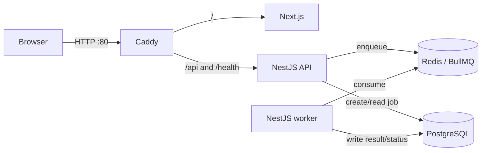

# VEGAH Queue Lab

A small full-stack deployment exercise: submit text in the browser, enqueue it in Redis with BullMQ, process it in a separate worker, and store the result in PostgreSQL.

## Architecture



The browser submits a text payload to `POST /api/jobs` and receives an ID. The frontend polls `GET /api/jobs/:id`; the API reads status and results from PostgreSQL while the separate worker consumes the Redis queue. The worker returns word, sentence, character, and estimated reading-time metrics.

## Run locally

Requirements: Docker Desktop with Compose. For direct development, Node.js 22 and npm 10 are used.

```powershell
Copy-Item .env.example .env
docker compose up --build
```

Open [http://localhost](http://localhost). Submit a sample task and watch it complete. Stop with `Ctrl+C`; containers use restart policies. PostgreSQL and Redis data live in named Docker volumes and survive container replacement. To intentionally reset local data, use `docker compose down -v`.

The `.env.example` password is for local development only. Do not reuse it in a public environment. `.env` is ignored by Git.

## Configuration

| Variable | Purpose | Local default |
| --- | --- | --- |
| `POSTGRES_USER` | Database username | `vegah` |
| `POSTGRES_PASSWORD` | Local database password | `local-development-only` |
| `POSTGRES_DB` | Database name | `vegah` |
| `WEB_PORT` | Public proxy port | `80` |
| `IMAGE_TAG` | Release tag used by deployment | `local` |
| `IMAGE_PREFIX` | Base name for local or published images | vegah-local/vegah |

## Checks

```powershell
npm ci
npm test
npm run build
docker compose config --quiet
./scripts/smoke.ps1 -RestartServices
```

The worker unit tests cover text analysis. The Compose smoke flow is to submit a job in the UI, confirm status reaches `completed`, verify the result fields, restart the API/worker containers, and confirm the result remains available. API readiness checks both PostgreSQL and Redis. Containers do not publish database or Redis ports.

## CI/CD

`.github/workflows/ci-cd.yml` runs tests, builds, and Compose validation for pull requests. On pushes to `main`, it builds three images and publishes immutable commit-SHA tags to private ECR repositories, then requests a deployment on the EC2 host through AWS Systems Manager. GitHub Actions assumes an AWS IAM role with GitHub OIDC; it uses no long-lived AWS access key. A failed verification job blocks publication and deployment.

Before deployment:

1. Push the source to `saisasidharpaluri/vegah` and ensure the workflow is enabled. With no AWS deploy role configured, CI verification runs while image publication and deployment are skipped.
2. Deploy `infra/aws/template.yaml` in `us-east-1`. It creates a single-AZ VPC, Ubuntu EC2 host, encrypted 20 GB EBS volume, port-80-only security group, ECR repositories, and scoped Systems Manager/ECR/GitHub OIDC roles. The host clones the repository during bootstrap.
3. Set repository variables `AWS_DEPLOY_ROLE_ARN`, `AWS_REGION`, and `EC2_INSTANCE_ID` from the stack outputs. Run **Actions → Build and deploy → Run workflow** with `image_tag` blank for the first image build and deployment.
4. Later pushes to `main` deploy automatically. For rollback, run the workflow with a previously published 40-character commit SHA.
## AWS deployment architecture and cost

The assessment demo uses one EC2 host running the same Compose stack as local development. PostgreSQL and Redis are not public; PostgreSQL data and Redis AOF files use persistent Docker volumes on the encrypted EBS volume. Systems Manager handles administration; inbound SSH is not opened. Private images are stored in ECR and pulled by the instance profile. The public URL is HTTP on the EC2 address because no custom domain was provided. This is a low-traffic assessment environment, not a highly available production service.

The intended live window is seven days with a $10 project cost cap. At listed `us-east-1` rates, a `t3.medium` at $0.0418/hour is about $7.02 for 168 hours, one public IPv4 address at $0.005/hour is $0.84, and a 20 GB gp3 volume at $0.08/GB-month is about $0.37 for seven days: approximately **$8.24** before ECR storage, taxes, or unusual traffic. The instance uses standard CPU credits so sustained CPU use is throttled instead of incurring unlimited-mode credit charges. Check current account usage and image storage before stack creation, then monitor actual spend and remove the stack before reaching the cap. This is an estimate; AWS Budgets alerts are not a hard spending stop.

## Troubleshooting and recovery

- `docker compose ps` and `docker compose logs --tail=100 api worker postgres redis proxy` show service state and recent logs.
- `curl http://localhost/health/live` checks API liveness; `/health/ready` checks PostgreSQL and Redis connectivity.
- A failed deploy restores the previous SHA-tagged images. Data volumes are not removed by deployment or rollback.
- For queue failures, verify Redis health, inspect worker logs, then check the job row in PostgreSQL.
- Do not run `docker compose down -v` on the cloud host; it deletes persistent demo data.

## Known limitations

- One EC2 instance is a single point of failure; the deployment is intentionally small for an intern assessment.
- The public endpoint uses HTTP because a domain/certificate was not supplied. Do not enter sensitive data.
- Container logs are the demo's operational logs; a production system should add centralized metrics/log retention, backups, HTTPS, and multi-AZ managed data services.
